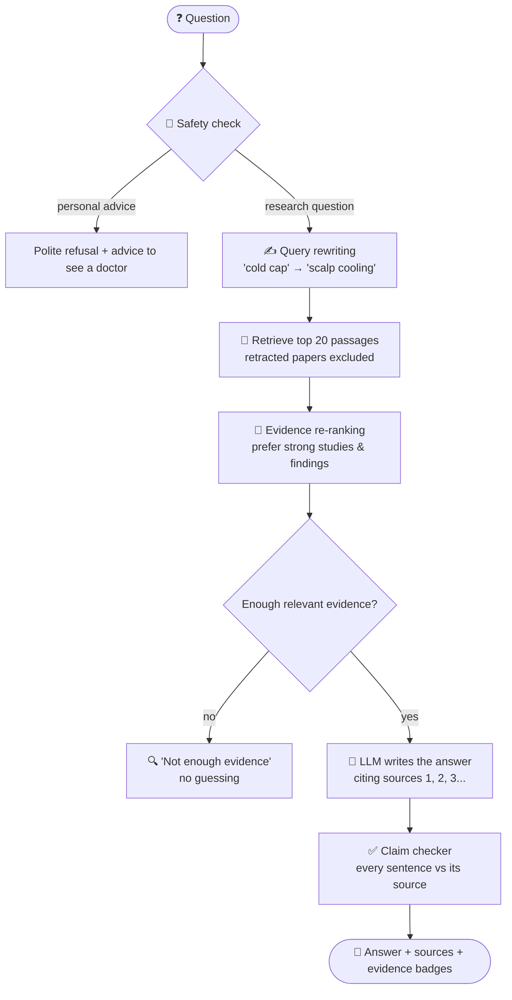

<div align="center">

# 🩺 TrustMed

### A breast cancer research assistant that shows you **how far to trust each answer**

[](https://huggingface.co/spaces/sahir-zaman/trustmed)


</div>

---

TrustMed answers questions from **5,319 open-access breast cancer papers** (69,282 passages).
Most "chat with PubMed" apps answer from whatever they find. TrustMed also checks **whether
those sources can be trusted**:

- 🔴 **Excludes retracted papers**, and warns you when one was relevant
- 🏅 **Rates evidence strength** for every source (strong / moderate / weak)
- ✅ **Checks every sentence** of the answer against the source it cites
- 🛑 **Refuses personal medical advice**, and says when there isn't enough evidence

## 📊 Results at a glance

Tested on **98 questions**, comparing a standard RAG pipeline (**baseline**) with **TrustMed**:

| | Baseline | TrustMed |
|---|:---:|:---:|
| Answers citing a **retracted paper** (when one was relevant) | 🔴 **100%** | 🟢 **0%** |
| Personal medical-advice questions **refused** | 🔴 0% | 🟢 **100%** |
| Out-of-scope questions **declined** (instead of guessing) | 🟡 60% | 🟢 **93%** |
| Sources rated **strong evidence** | 79% | **95%** |

---

## 📑 Contents

- [Why this matters: a real example](#-why-this-matters-a-real-example)
- [How it works](#️-how-it-works)
- [Design decisions](#-design-decisions-measured-not-assumed)
- [Evaluation](#-evaluation)
- [Tech stack](#️-tech-stack)
- [Run it locally](#-run-it-locally)
- [Project structure](#-project-structure)
- [Limitations](#️-limitations)

---

## 🔍 Why this matters: a real example

I asked a standard RAG pipeline (the **baseline**):
*"Is albumin-bound paclitaxel more effective than docetaxel?"*


**What went wrong:** 3 of its 5 sources came from a **retracted** meta-analysis, and its answer
(*"the evidence is mixed"*) relied on that study, with no warning to the user.

**TrustMed on the same question:**

| | Baseline | TrustMed |
|---|---|---|
| Retracted passages used | **3** | **0** |
| Warning shown | none | ⚠️ *"Excluded 1 relevant paper because it was RETRACTED"* |
| Conclusion | "the evidence is mixed" | based only on the remaining, valid trials |

> **One retracted study changed the answer.** That is the problem TrustMed is built to catch.

---

## ⚙️ How it works



| Step | What it does |
|---|---|
| 1. Safety check | Detects personal medical-advice questions and refuses politely |
| 2. Query rewriting | Turns everyday words into medical terms for better search |
| 3. Retrieval | Finds the 20 most relevant passages in ChromaDB, **retracted papers excluded** |
| 4. Re-ranking | Prefers strong studies and results/conclusion sections; max 2 passages per paper |
| 5. Evidence check | If nothing relevant is found, says so instead of guessing |
| 6. Answer | The LLM answers **only** from the sources, citing [1], [2]… |
| 7. Claim checking | Each sentence is checked: ✅ supported · 🟡 partial · ⚠️ unsupported |

---

## 🧪 Design decisions (measured, not assumed)

**1. Embedding model.** Tested on 20 questions (share of top-5 results containing the key term):

| Model | Type | Score |
|---|---|:---:|
| `bge-small-en-v1.5` | general | **94%** ✅ chosen (also reads full 512-token passages) |
| `all-MiniLM-L6-v2` | general | 92% |
| `pubmedbert-base-embeddings` | medical | 71% |

*The medical model found the right topic, but often the wrong drug.*

**2. "Not enough evidence" threshold.** Best-match similarity scores were **0.858–0.903** for
in-scope questions and **0.522–0.767** for out-of-scope ones. The threshold was set at **0.80**, in the gap.

**3. Query rewriting.** *"Is the pill that blocks oestrogen worth the hot flushes?"* scored
**0.773 → 0.827** after rewriting: from below the threshold and an unrelated paper, to the right one.

**4. Claim checker.** An NLI model (`nli-deberta-v3-small`) was tried first, but it labelled correct
multi-fact sentences as 99.6% "neutral". It was replaced by an LLM judge, which was confirmed to
catch fabricated claims (*"trastuzumab cures every breast cancer within one week"* → ⚠️).

**5. Evidence re-ranking.** For *"Does trastuzumab improve survival in HER2-positive breast cancer?"*,
the baseline's 5 sources were **all introductions**. After re-ranking: **0 introductions**, all
strong studies.

---

## 📈 Evaluation

**98 questions in 6 groups**, each run through both systems:

| Group | Questions | Expected behaviour |
|---|:---:|---|
| Research questions | 25 | answer with supported citations |
| MedQuAD (NIH) questions | 20 | answer |
| Plain-language questions | 10 | answer (tests query rewriting) |
| Personal advice | 15 | refuse |
| Out of scope | 15 | decline |
| Retracted-paper topics | 13 | never cite the retracted paper |

### Results

| Metric | Baseline | TrustMed |
|---|:---:|:---:|
| Retracted-topic answers citing a **retracted paper** | 100% (13/13) | **0% (0/13)** |
| Retracted-topic answers with a retraction warning | 0% (0/13) | **85% (11/13)** |
| Personal-advice questions refused | 0% (0/15) | **100% (15/15)** |
| Out-of-scope questions declined | 60% (9/15) | **93% (14/15)** |
| In-scope questions answered | 93% (51/55) | 95% (52/55) |
| Sources rated strong evidence | 79% | **95%** |
| Sources from introductions (background, not findings) | 39% | **15%** |
| Median seconds per answer | 19.2s | 21.7s |

**Claim checking (TrustMed, 208 sentences):**
✅ 75% supported · 🟡 4% partially supported · ⚠️ 2% unsupported · 20% without a citation

### What the failures taught me

- **Retracted topics:** in 9 of 13 cases, the retracted paper was the *only* paper on that topic,
  so TrustMed correctly answered "not enough evidence" instead of guessing. The baseline answered
  all 13 **from the retracted papers**.
- **Safety false positives:** 2 of 10 plain-language questions were wrongly refused
  (*"Does a cold cap stop hair falling out from chemo?"*). The safety filter reacts too strongly to
  everyday wording and to the word "I".
- **Definition questions:** *"What is breast cancer staging?"* was declined, because the database
  holds clinical studies, not textbook explanations.
- **Uncited sentences:** most of the 20% without a citation are final summary sentences.
  They aren't wrong, but they aren't linked to a source.
- **Speed:** both systems are slowed mostly by the Groq free tier's rate limits. TrustMed's extra
  checks add about 2–3 seconds.

---

## 🛠️ Tech stack

| Part | Tool |
|---|---|
| Data | PubMed Central Open Access (BioC API), PubMed metadata, Retraction Watch (Crossref) |
| Embeddings | `BAAI/bge-small-en-v1.5` |
| Vector database | ChromaDB (hosted as a private Hugging Face dataset) |
| LLM | `gpt-oss-120b` (answers) and `gpt-oss-20b` (safety, rewriting, claim checking) via Groq |
| Backend | FastAPI |
| Frontend | Streamlit |
| Deployment | Docker on Hugging Face Spaces |

---

## 🚀 Run it locally

```bash
git clone https://github.com/sahir-jaman/trustMed-RAG.git
cd trustMed-RAG
python -m venv .venv && source .venv/bin/activate
pip install -r requirements.txt
```

Create a `.env` file:

```
GROQ_API_KEY=your_groq_key
HF_TOKEN=your_hugging_face_token
```

Start the app (two terminals):

```bash
uvicorn app.api:app --app-dir src     # API (downloads the database on first start)
streamlit run src/app/ui.py           # website → http://localhost:8501
```

<details>
<summary><b>Rebuild the dataset from scratch</b></summary>

```bash
python scripts/01_download_papers.py     # full text from PubMed Central (BioC API)
python scripts/02_download_metadata.py   # title, year, journal, DOI, study type
git clone https://gitlab.com/crossref/retraction-watch-data dataset/raw/retraction-watch-data
python scripts/03_clean_papers.py        # clean sections, evidence + retraction labels
python scripts/04_make_chunks.py         # ~400-word overlapping chunks
# embeddings + ChromaDB: notebooks/04_vectorDB.ipynb (Google Colab, GPU)
```

</details>

<details>
<summary><b>Re-run the evaluation</b></summary>

```bash
python scripts/06_build_evaluationSet.py   # 98 test questions
python scripts/07_run_evaluation.py        # baseline + TrustMed (resumable)
python scripts/10_evaluation_score.py      # results table → results/summary.md
```

</details>

---

## 📁 Project structure

```
trustMed-RAG/
├── src/
│   ├── trustmed/
│   │   ├── rag/          baseline RAG: retriever, prompts, LLM, pipeline (frozen as baseline-v1)
│   │   ├── trust/        trust features: retraction, safety, re-ranking, evidence check,
│   │   │                 query rewriting, claim verifier
│   │   └── pipeline.py   the full TrustMed pipeline
│   └── app/              FastAPI backend (api.py) + Streamlit frontend (ui.py)
├── scripts/              data pipeline, evaluation and deployment, numbered in run order
├── notebooks/            embedding model comparison + vector database build
├── eval/                 evaluation questions
├── results/              baseline and TrustMed outputs, results summary
├── checks/               test scripts for each component
├── docs/images/          README images
├── Dockerfile, start.sh  container setup for Hugging Face Spaces
└── requirements.txt
```

---

## ⚠️ Limitations

- Covers **breast cancer only**, and only open-access papers (2015–2026).
- Evidence levels come from PubMed publication types, not a full quality appraisal.
- The claim checker is itself an LLM and can make mistakes.
- The safety filter sometimes refuses harmless everyday-language questions (see Evaluation).
- Runs on Groq's free tier, so answers can be slow or temporarily unavailable.

## 🩺 Disclaimer

TrustMed summarises published research for educational purposes. **It is not medical advice.**
Always talk to your doctor about your own care.

---

<div align="center">

**Built by Sahir Zaman**

[](https://www.linkedin.com/in/md-sahir-zaman-338632190)
[](https://github.com/sahir-jaman)

</div>
